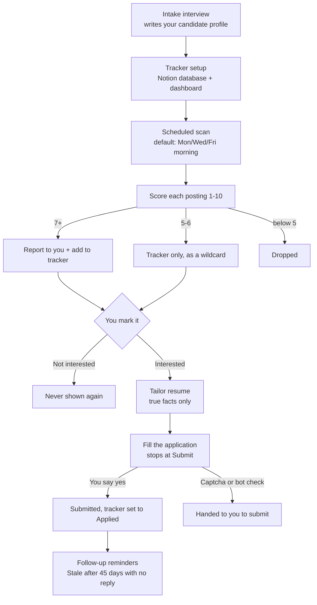

# ai-job-hunter

An AI agent that finds jobs that fit you, keeps them in a Notion tracker, and gets each application ready for you to submit.

## The problem

Job hunting is mostly repetitive work. You check the same boards every few days, reread postings you already passed on, lose track of where you applied, forget to follow up, and rewrite your resume for every role. This package hands that work to an AI agent while you keep every decision that matters: which jobs to pursue, what your resume says, and when to press Submit.

## How it works

You set it up once. After that, the agent scans for new postings on a schedule, scores each against your profile, and messages you only when something is worth your time. Everything it finds lands in a Notion tracker. When you mark a job Interested, it tailors your resume and fills out the application, then stops and waits for your yes.

Each step is a separate skill in `skills/`, so you can use one on its own or swap it out. All of them follow the same rules in `guardrails/GUARDRAILS.md`.

## Skills

| Skill | What it does | When to use it |
|---|---|---|
| `job-hunter-setup` | Interviews you and writes your candidate profile | First setup, or when your goals change |
| `notion-tracker-setup` | Builds the Notion tracker database and the Dashboard views | Once during setup, or if the tracker breaks |
| `job-scan` | Searches job boards, company career pages, and optional clearance or government boards, and skips duplicates | Every scheduled scan, or "find me jobs" |
| `job-scoring` | Scores each posting 1 to 10 against your profile | After a scan, or "is this a good fit?" |
| `job-report` | Sends the 7+ matches and due follow-ups in a short format, or nothing | End of each scan |
| `resume-tailoring` | Tailors your resume (and a cover letter if needed) using only true facts | When you mark a job Interested |
| `apply-to-job` | Fills the employer's application and stops at Submit until you say yes | When you say "apply to <company> <role>" |
| `tracker-updates-and-followups` | Updates statuses, reminds you of follow-ups, and marks rows Stale after 45 days | When you report news, and on each scan |
| `recruiter-message-draft` | Writes a short message for you to send | Follow-ups, thank-yous, replies |
| `scan-routine-setup` | Creates or changes the scheduled scan from `templates/routines.md` | During setup, or to change or pause the schedule |

Every skill follows `guardrails/GUARDRAILS.md`. Personal details (your schedule, accounts, links) live in `templates/`, not in the skills.

## Quick start

**With Grok Bot (recommended)**
1. Download or clone this repo.
2. Create a new Grok Bot and give it the files in this repo (start with `SETUP.md`).
3. Tell it: "Read SETUP.md and walk me through setting up my job hunter."
4. Answer its questions. It will help you make a Notion account, connect Notion, build your profile and tracker, set up your bot persona and skills, schedule the scan, and run a first test scan with you.

**With another AI agent (Claude, ChatGPT, Cursor, and others)**
1. Download or clone this repo.
2. Give the agent `SETUP.md` and say: "Follow this to set me up."
3. See `docs/other-llms.md` for how to load the persona and skills, and what to do when your agent can't schedule tasks or use a browser.

**Importing the skills into a bot**
- **Grok Bot:** save each `skills/<name>/SKILL.md` as a skill on your bot, keeping its name and description, and give the bot `guardrails/GUARDRAILS.md` too. `SETUP.md` has the bot do this with you. Paste the filled `templates/persona.md` as the bot's instructions, and create the scan from `templates/routines.md`.
- **Other agents:** see `docs/other-llms.md` for where the persona, skills, and schedule go on each platform.

Setup takes about 30 to 60 minutes, most of it the intake interview.

## Requirements

- **An AI agent with web search and a browser.** Grok Bot has both, plus scheduled routines. Other agents work if they can search the web; without a browser you fill forms yourself from the answers it prepares.
- **A Notion account** (the free plan is enough) and the **Notion connector** for your agent, so it can read and write the tracker.
- **Google Docs (optional)** if you want tailored resumes as editable Docs. Otherwise the agent makes PDFs.
- Your current resume.

## Usage

Once it's set up, you mostly react to messages:

- **A scan report arrives.** Each hit has the title, company, location, posted date, why it fits, one honest gap, and a link. Quiet days mean nothing cleared the bar.
- **Open the Dashboard in Notion.** "New matches to review" lists everything the scan found. Set Status to **Interested** or **Not interested**. Tick **⭐ Favorite** on the ones you care most about.
- **Say "apply to <company> <role>."** The agent reads the posting, tailors your resume, shows it to you, fills the employer's form, and shows you every answer before you approve the submission.
- **Tell it what happened.** "I got an interview at X" or "Y rejected me." It updates the tracker and reminds you of follow-ups.
- **Recruiter messages are drafts.** The agent writes them and you send them.

`PROCESS.md` describes the full method step by step.

## Safety rules

Two rules are built into every skill (see `guardrails/GUARDRAILS.md`):

- **Nothing is submitted without your permission.** The agent never applies, submits a form, or creates a job-site account unless you say yes for that specific posting. A yes for one job doesn't carry over to the next.
- **Personal info and logins go in the vault.** Your email, phone, address, job-site passwords, and cards are stored in Grok Bot's Vault (or a password manager you control with other agents), not in the profile file, the tracker, or chat.

## Limits and known gaps

- **The agent can make mistakes.** It can misread a posting, score a job wrong, or fill in a field incorrectly. That's why you review the resume and every form answer before anything is sent.
- **Captchas and bot checks need you.** The agent tries once, then hands you the link and your approved answers to submit yourself.
- **Site terms.** Some job sites restrict automated use. The agent never submits without you and never creates accounts for you, but you are responsible for following each site's rules.
- **No per-view row counter in Notion.** The "#" column is a fixed ID in the order rows were created. It doesn't renumber from 1 when you sort or filter a view.
- **Job boards change.** Search pages and login walls change often, so some sources will return less over time. The company watchlist and employer career pages are the most reliable sources.
- **Scheduling depends on your agent.** Grok Bot runs the scan on its own. Other agents may need you to start each scan.
- **US-centric defaults.** The application answers in the profile template (veteran status, EEO questions, work authorization) follow US forms. Edit them for your country.

## License

MIT. See [LICENSE](LICENSE).
